<h1 align="center">
  <picture>
    <source media="(prefers-color-scheme: dark)" srcset="assets/brand/diffcraft-wordmark-on-dark.png">
    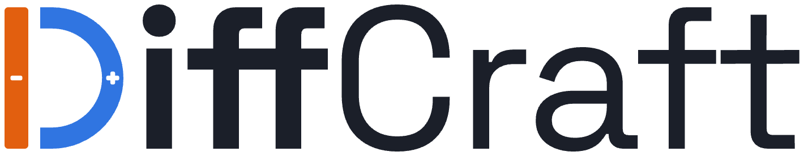
  </picture>
</h1>

<p align="center">
  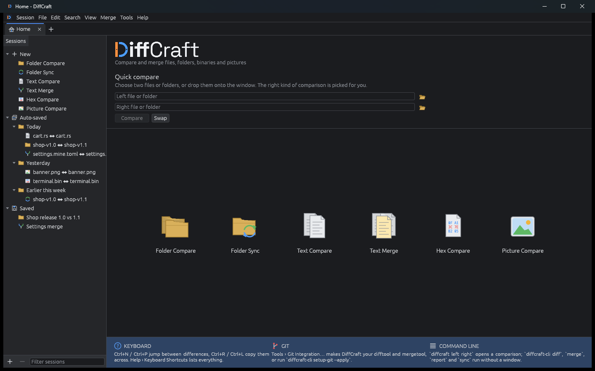
  <br>
  <sub>The start page: pick a session type, reopen a recent or saved session, or drop two files onto the window.</sub>
</p>

<p align="center">
  <b>Compare and merge files, folders, binaries and pictures. A free, open-source diff and merge tool, written in pure Rust.</b><br>
  Side-by-side text with edits, three-way merge, folder compare and sync, hex and picture compare,<br>
  in a native app for Windows, Linux and macOS. No licence key, no activation, no telemetry.
</p>

<p align="center">
  
  
  
  
  <a href="https://github.com/theoddprince/diffcraft/actions/workflows/ci.yml"></a>
</p>

<br>


<p align="center">
  <a href="#features">Features</a> ·
  <a href="#command-line">Command line</a> ·
  <a href="#git-integration">Git</a> ·
  <a href="#get-started">Get started</a> ·
  <a href="#downloads">Downloads</a> ·
  <a href="#under-the-hood">Under the hood</a> ·
  <a href="#license-and-credits">License</a>
</p>

<br>

<table>
  <tr>
    <td width="25%" valign="top">
      <h3>🔍 Six ways to compare</h3>
      Text, three-way merge, folders, folder sync, hex and pictures, each with its own view. Open two paths and the right one is picked for you.
    </td>
    <td width="25%" valign="top">
      <h3>⚡ Native and fast</h3>
      egui on wgpu (DirectX 12, Vulkan, Metal, OpenGL). Diffs, scans and decoding run in the background, and only the visible rows are drawn. No Electron, no web view.
    </td>
    <td width="25%" valign="top">
      <h3>🛡️ Careful with your files</h3>
      Saving keeps each file's encoding, byte-order mark and line endings. Writes are atomic, deletes go to the Recycle Bin or Trash, and bad input gives an error message, never a crash.
    </td>
    <td width="25%" valign="top">
      <h3>🧰 Scriptable</h3>
      Headless <code>diff</code>, <code>merge</code>, <code>report</code> and <code>sync</code> commands with <code>diff</code>-style exit codes, plus one-step set-up as git's difftool and mergetool.
    </td>
  </tr>
</table>

## Features

### Home

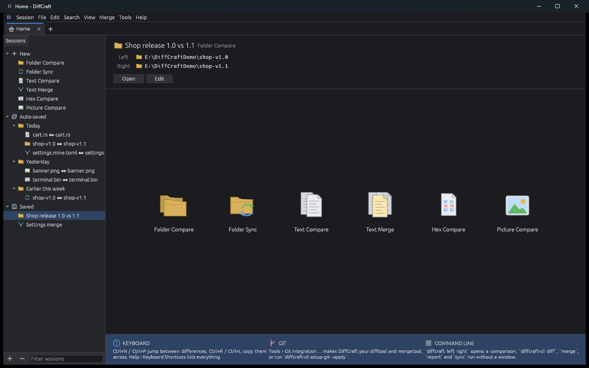

- A **Sessions** tree on the left:
  - **New** starts any of the six session types.
  - **Auto-saved** keeps every comparison you open, grouped by Today, Yesterday, Earlier this week and Older.
  - **Saved** holds the sessions you named.
- Select a session to see its paths, then **Open** it or **Edit** its name and paths.
- **Quick compare:** give two paths, or drop them onto the window, and DiffCraft picks the view: folders, pictures, binary or text.

### Text Compare

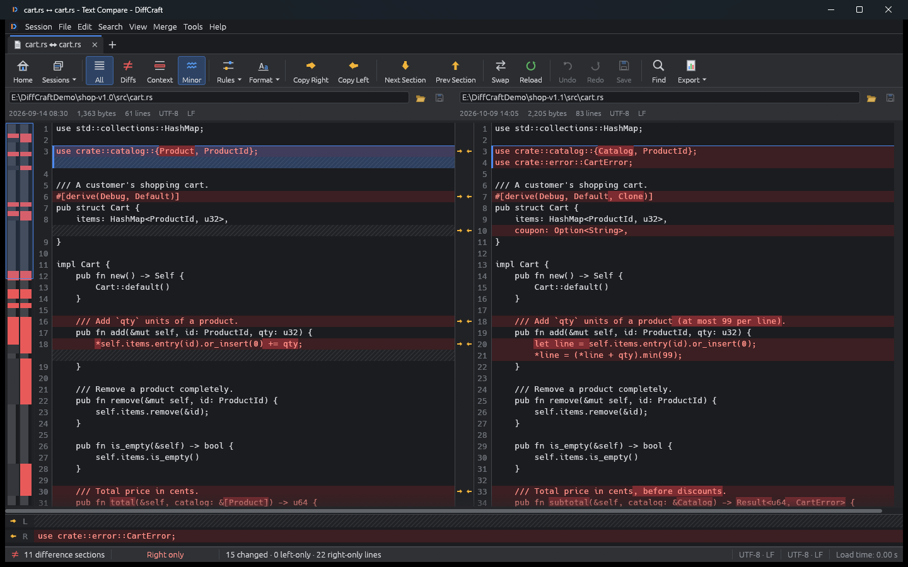

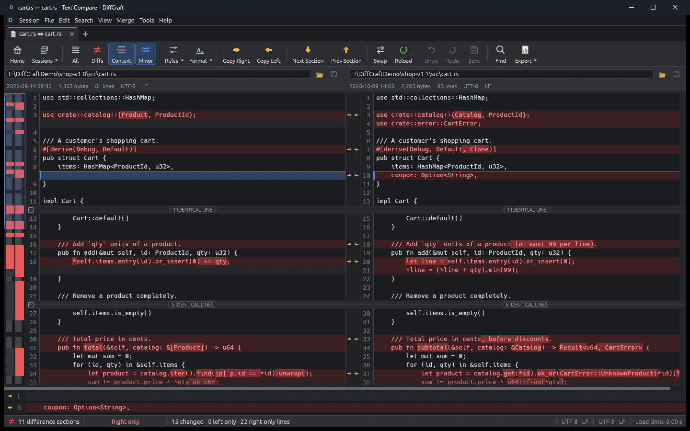

- **Rows stay aligned** across the two files, the changed words inside a line are highlighted, and hatching marks lines that exist on one side only.
- **All / Diffs / Context** show every line, only the differences, or the differences with three lines of context.
- **Minor** toggles highlighting of unimportant differences.
- **Rules** decide what counts as unimportant:
  - leading/trailing whitespace, changes in the amount of whitespace, or all whitespace;
  - case;
  - inserted or deleted blank lines;
  - text matching your own regular expressions, such as `\$Id:.*\$` or timestamps.

  You can also choose the **Myers**, **Patience** or **Histogram** diff algorithm, and set rules per file type.
- **Editing:**
  - Double-click a line to edit it in place; Enter splits the line.
  - Copy a difference left or right from the gutter arrows or with <kbd>Ctrl+R</kbd> / <kbd>Ctrl+L</kbd>.
  - Insert or delete lines, or edit a whole file.
  - Undo and redo everything.
- **Navigation:**
  - Next/Prev Section with <kbd>Ctrl+N</kbd> / <kbd>Ctrl+P</kbd>.
  - Click the thumbnail overview to jump.
  - Find with <kbd>Ctrl+F</kbd> and go to line with <kbd>Ctrl+G</kbd>.
- **Saving:**
  - Each file keeps its encoding (UTF-8, UTF-16, Windows-125x, Shift_JIS, GBK and more), its byte-order mark and its line endings.
  - The **Format** menu changes any of these.
  - Files edited outside DiffCraft reload automatically.
- **Export** an HTML side-by-side report or a unified patch.

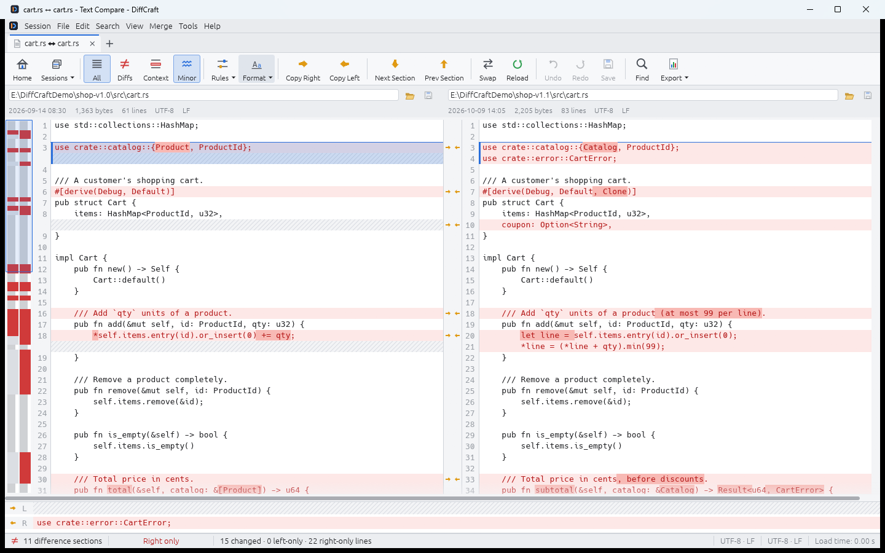

<sub>Every view comes in a dark and a light theme, or follows the system.</sub>

### Text Merge

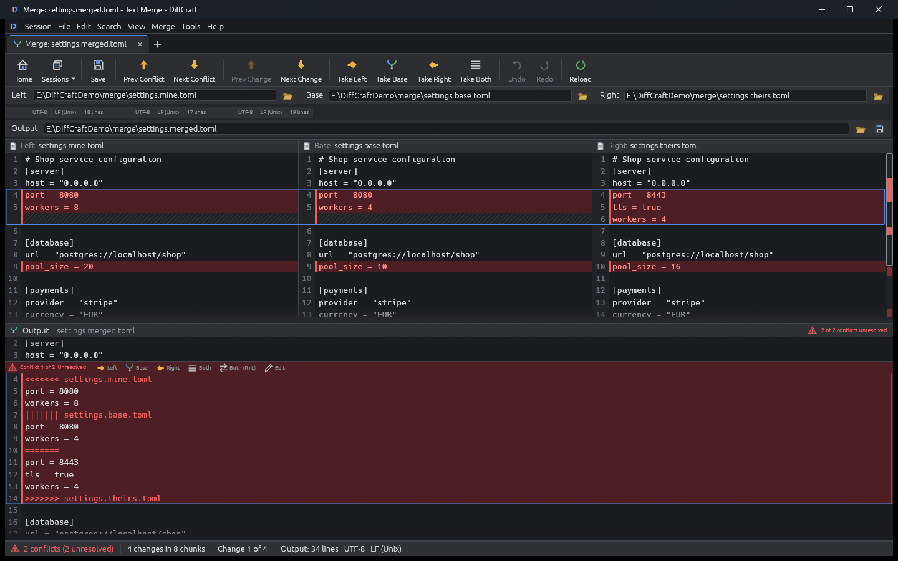

- **Three-way merge** of left and right against their common base. Changes that don't overlap merge automatically.
- **For each conflict**, take Left, Base, Right, Left+Right or Right+Left, or **edit** the result by hand. Every choice can be undone.
- **Conflict navigation:** <kbd>Ctrl+Shift+N</kbd> / <kbd>Ctrl+Shift+P</kbd>.
- **Saving:** the result is saved with the left file's encoding and line endings. With unresolved conflicts it saves conflict markers, after asking.
- **Git:** works as `git mergetool`, and exits with 0 only when you saved a clean merge.

### Folder Compare

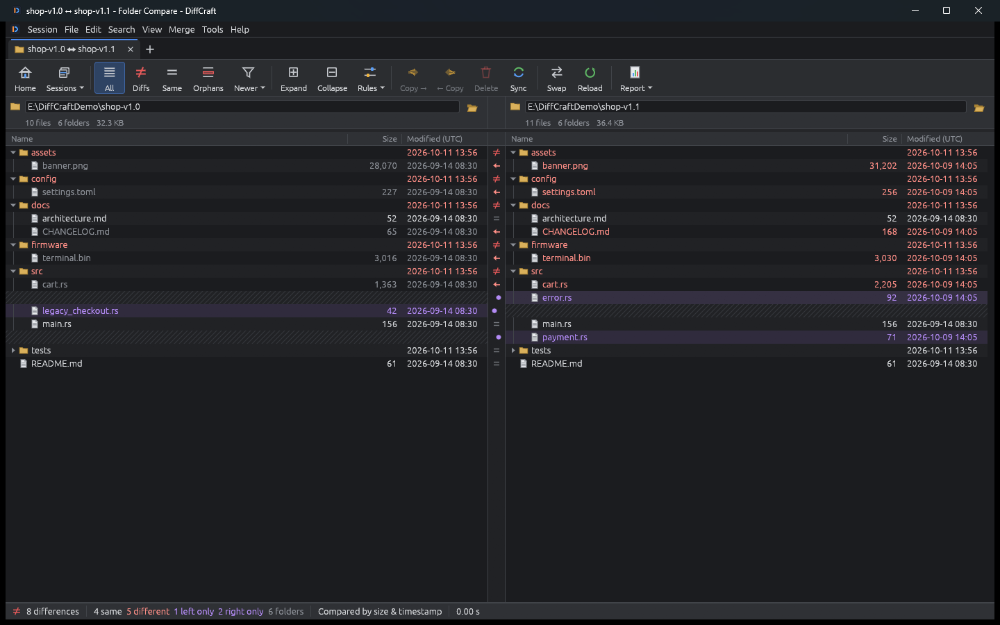

- **Two trees side by side**, compared by size and timestamp, size only, timestamp only, CRC-32, binary contents, or text rules (for example, ignore whitespace).
- **Filters** such as `*.rs;*.toml;-target/;-*.bak`, and show or hide hidden files.
- **Comparison options:**
  - a timestamp tolerance (for FAT and network shares);
  - ignoring 1-hour daylight-saving shifts;
  - case-sensitive names (the default follows the platform);
  - following symlinks.
- **Show** All, Differences, Same, Orphans, Left newer or Right newer.
- **File operations:**
  - Copy →, ← Copy, move, delete (to the Recycle Bin or Trash) and rename;
  - new folder, show in file manager and copy path.
- **Double-click** a file to open it in the right compare view.
- **Reports** in HTML or CSV.

### Folder Sync

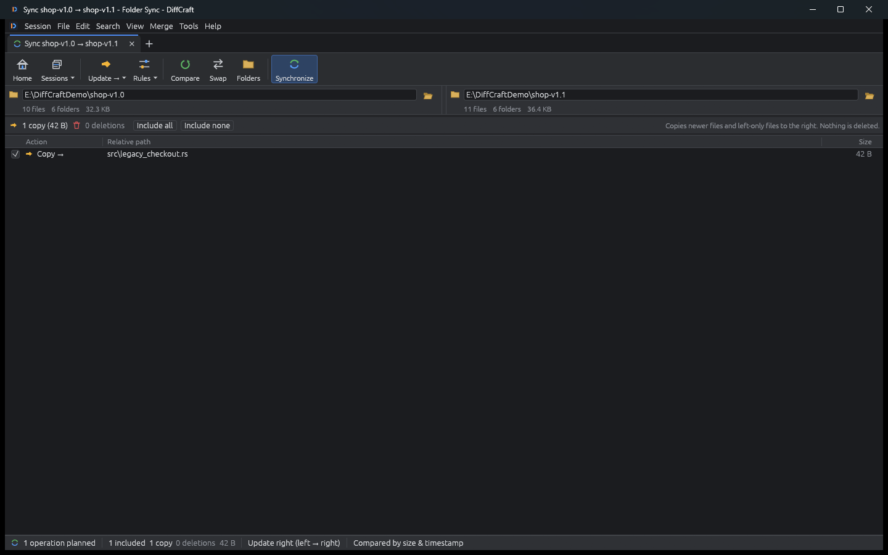

- **Modes:** Update right, Update left, Update both, Mirror left → right, Mirror right → left.
- **Preview first:** every copy and deletion is listed with its size, and you can untick any of them.
- **Run** it with progress and cancel, and see a report of any failures afterwards.

### Hex Compare

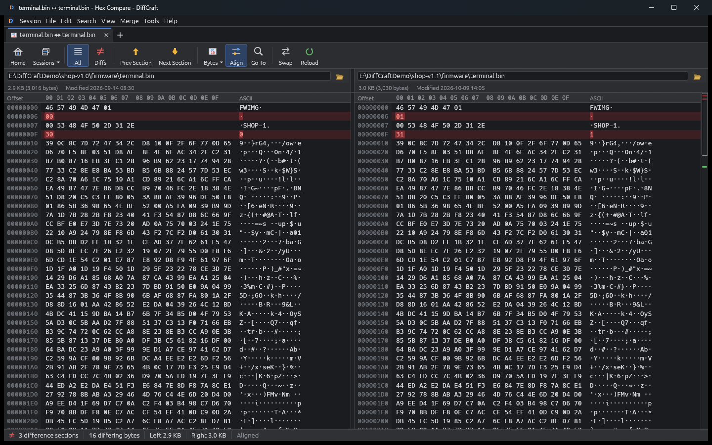

- **Byte by byte** with offset, hex and ASCII columns, and 8, 16 or 32 bytes per row.
- **Align** finds inserted and deleted bytes instead of reporting everything after an insertion as different.
- **Navigation:** next/prev section and go to offset (decimal or `0x…`).
- **Large files:** files up to 1 GiB, with smooth scrolling.

### Picture Compare

<p>
  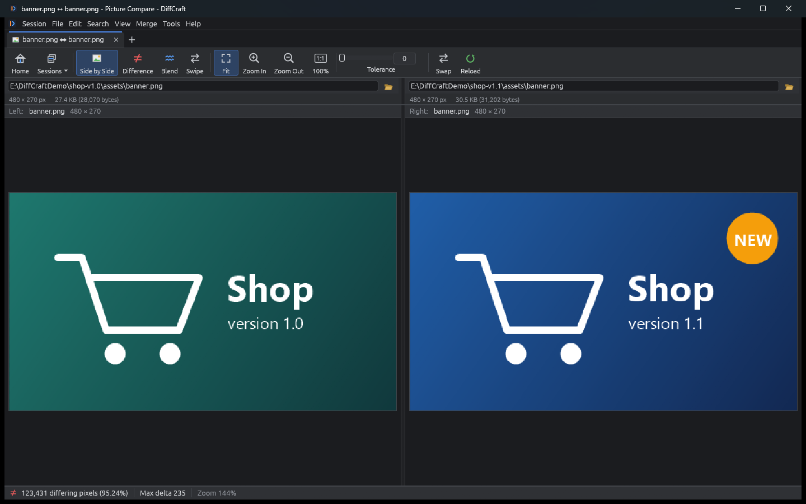
  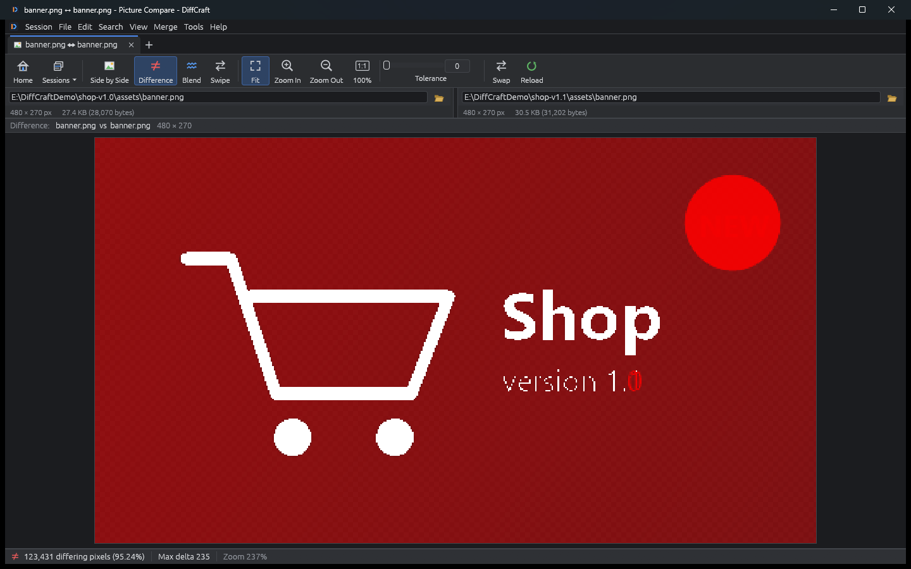
</p>

- **Modes:** side by side, a difference mask, a blend with an opacity slider, or a swipe divider.
- **Tolerance** decides how far a pixel's colour may change before it counts as different.
- **Zoom and pan:** Fit, 100% and Ctrl+wheel zoom; both sides zoom and pan together.
- **Readouts:** the pixel under the cursor (both RGBA values), the count of differing pixels and the largest colour difference.
- **Formats:** PNG, JPEG, GIF, BMP, WebP, TIFF, ICO and TGA.

## Command line

```sh
diffcraft                                         # Home screen
diffcraft left.txt right.txt                      # opens the right view for the contents
diffcraft dirA dirB                               # Folder Compare
diffcraft --view sync dirA dirB                   # Folder Sync
diffcraft mine.txt theirs.txt base.txt -o out.txt # Text Merge
```

Headless commands follow the `diff` exit codes:

| Exit code | Meaning |
|---|---|
| **0** | The inputs are the same. |
| **1** | They differ, or a merge has conflicts. |
| **2** | Error. |

On Windows, use `diffcraft-cli.exe` for these. It is the console build of the same program.

```sh
diffcraft-cli diff a.txt b.txt                         # coloured unified diff
diffcraft-cli diff -w changes -i a.txt b.txt           # ignore whitespace changes and case
diffcraft-cli diff --compare binary dirA dirB          # list folder differences
diffcraft-cli merge mine.txt theirs.txt base.txt -o merged.txt
diffcraft-cli report a.txt b.txt --html report.html --patch changes.patch
diffcraft-cli report dirA dirB --csv report.csv --only-differences
diffcraft-cli sync src/ backup/ --mode mirror-right --dry-run
diffcraft-cli sessions                                 # saved and recent sessions
diffcraft-cli open "Shop release 1.0 vs 1.1"           # open a saved session
```

## Git integration

```sh
diffcraft-cli setup-git --apply   # registers difftool and mergetool "diffcraft"
git difftool
git mergetool
```

The same set-up is in the app under **Tools › Git Integration…**.

## Keyboard shortcuts

On macOS, use <kbd>Cmd</kbd> where this table says <kbd>Ctrl</kbd>.

| Keys | Action |
|---|---|
| <kbd>Ctrl+N</kbd> / <kbd>Ctrl+P</kbd> (also <kbd>F8</kbd> / <kbd>F7</kbd>, <kbd>Alt+↓</kbd> / <kbd>Alt+↑</kbd>) | Next / previous difference |
| <kbd>Ctrl+Shift+N</kbd> / <kbd>Ctrl+Shift+P</kbd> | Next / previous conflict |
| <kbd>Ctrl+R</kbd> / <kbd>Ctrl+L</kbd> | Copy to right / left |
| <kbd>Alt+1</kbd> … <kbd>Alt+4</kbd> | Merge: take left / base / right / both |
| <kbd>Ctrl+S</kbd> | Save |
| <kbd>Ctrl+Z</kbd> / <kbd>Ctrl+Y</kbd> | Undo / redo |
| <kbd>Ctrl+F</kbd>, <kbd>F3</kbd> | Find, find next |
| <kbd>Ctrl+G</kbd> | Go to line |
| <kbd>F5</kbd> | Reload |
| <kbd>Ctrl+T</kbd> / <kbd>Ctrl+W</kbd> | Home / close tab |
| <kbd>Del</kbd>, <kbd>F2</kbd> | Delete, rename (folder view) |

**Help › Keyboard Shortcuts** lists them all.

## Get started

You need a stable Rust toolchain, 1.88 or newer, from [rustup.rs](https://rustup.rs).

```sh
git clone https://github.com/theoddprince/diffcraft
cd diffcraft
cargo build --release
./target/release/diffcraft          # Windows: target\release\diffcraft.exe
```

| OS | Notes |
|---|---|
| **Windows 10/11** | Builds as-is with the MSVC toolchain. `packaging\windows\build.ps1` makes a portable `.zip`. |
| **Linux (X11 and Wayland)** | Install the windowing libraries first (`sudo apt install libxkbcommon-dev libwayland-dev libx11-dev libxrandr-dev libxi-dev libgl1-mesa-dev`). `packaging/linux/build.sh` builds a `.tar.gz`, and also a `.deb` and an AppImage if `cargo-deb` and `appimagetool` are installed. |
| **macOS 11+** | `packaging/macos/build.sh` builds a universal (Apple Silicon and Intel) `DiffCraft.app` inside a `.dmg`. |

On a machine or VM without a working GPU driver, start DiffCraft with `DIFFCRAFT_RENDERER=glow` to use the OpenGL renderer.

Settings and sessions are stored as JSON:

| OS | Location |
|---|---|
| Windows | `%APPDATA%\theoddprince\DiffCraft\config` |
| macOS | `~/Library/Application Support/io.github.theoddprince.DiffCraft` |
| Linux | `~/.config/diffcraft` |

`DIFFCRAFT_CONFIG_DIR` overrides the location, for example for a portable install.

## Downloads

Pre-built packages are attached to each [release](https://github.com/theoddprince/diffcraft/releases). Pushing a tag such as `v0.1.0` runs the release workflow, which builds:

- a Windows portable `.zip`;
- a macOS universal `.dmg`;
- Linux `.tar.gz`, `.deb` and AppImage packages.

## Under the hood

```text
crates/diffcraft-core      the engine (no UI):
                           - Myers (linear space), Patience and Histogram diff
                           - comparison rules, side-by-side alignment, intra-line diff
                           - three-way merge
                           - byte alignment for the hex view, pixel diff
                           - parallel folder scan and compare, folder sync
                           - encoding-preserving text files
crates/diffcraft-session   sessions, settings, file-format rules, git integration
crates/diffcraft-report    unified patches, HTML side-by-side reports, folder HTML/CSV reports
crates/diffcraft-ui        the egui/eframe app: theme, vector icons, toolbars, all seven views
apps/diffcraft             the diffcraft (GUI) and diffcraft-cli (console) binaries
```

- **The engine is fully testable without a window.** The diff algorithms are checked with property tests: the hunks must always rebuild the right-hand file, and Myers is never beaten on edit distance.
- **Never crash on input.** Non-test code has no `unwrap`, `expect` or `panic!`, and `unsafe` is forbidden. Background work turns a panic into an error message. A corrupt settings file is moved aside instead of stopping the app.
- **The icons are vector shapes** drawn by the app, so they are crisp at any scale and never depend on font glyphs. For symbols, CJK and other scripts in your files, DiffCraft uses the fonts already on your system.
- **CI** builds, lints and tests on Windows, Linux and macOS for every push.

## License and credits

The code is dual-licensed under [MIT](LICENSE-MIT) or [Apache-2.0](LICENSE-APACHE), at your option.

- The DiffCraft logo and wordmark in [`assets/brand`](assets/brand) belong to the project owner; please use them only to refer to DiffCraft.
- The screenshots use a made-up demo project.
